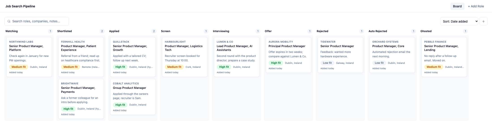
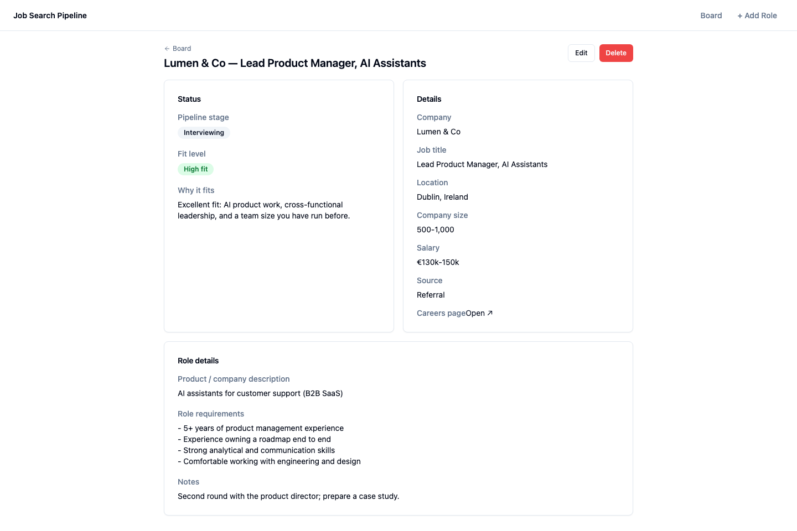

# Job Search Pipeline

A small web app for running a job search like a pipeline. Paste a job posting link (or upload the job description) and Claude fills in the role details and tells you how well it fits your CV. Then track every opportunity on a Kanban board.

I built it as a Product Manager who wanted a better tool than a markdown list, and to practise building with AI tools. It is a personal, single-user app: simple on purpose.



<sub>Demo data: every company and role in these screenshots is fictional.</sub>

- Original requirements: [PRD.md](PRD.md)
- How the pieces fit together: [ARCHITECTURE.md](ARCHITECTURE.md)

## What it does

- **Add a role three ways:** paste a URL, upload a PDF/DOC/DOCX job description, or enter it by hand.
- **AI auto-fill:** Claude extracts company, title, location, company size, salary, requirements and a short product description from the posting.
- **Fit assessment:** Claude compares the role to your CV and suggests a fit level (High / Medium / Low) with a short "why it fits". You can override both.
- **Pipeline board:** drag cards between stages: Watching, Shortlisted, Applied, Screen, Interviewing, Offer, Rejected, Auto Rejected, Ghosted.
- **Search and sort:** search across roles, companies and notes; sort by fit, date added or company name.
- **Auto-ghosting:** roles that sit in Applied or Screen for 6 weeks move to Ghosted by themselves.
- **Password-protected:** one shared password, checked on the server.

## A role up close



## Tech stack

| Layer | Choice |
| --- | --- |
| Frontend | React, Vite, Tailwind CSS, shadcn/ui |
| Backend | Python, FastAPI |
| Database | SQLite (one file) |
| AI | Claude API (`claude-opus-4-6`) |
| Hosting | Railway, with a volume for the database |

Why these: SQLite and one FastAPI service keep it easy to run and maintain on your own. There is no separate database server and no user accounts. The built frontend is served by the same backend, so there is one thing to deploy.

## Run it locally

You need Python 3.11+, Node.js 18+ and an [Anthropic API key](https://console.anthropic.com/).

**Backend**

```bash
cd backend
pip install -r ../requirements.txt
export ANTHROPIC_API_KEY="sk-ant-..."
export CV_PATH="/path/to/your/cv.md"
uvicorn main:app --reload
```

**Frontend** (in a second terminal)

```bash
cd frontend
npm install
npm run dev
```

Open [http://localhost:5173](http://localhost:5173). With no `APP_PASSWORD` set, the app runs locally without a login screen.

To rebuild the version the backend serves, run `npm run build` in `frontend/`. The output goes to `frontend/dist`, which is committed.

## Configuration

| Variable | Needed | Purpose |
| --- | --- | --- |
| `ANTHROPIC_API_KEY` | Yes | Claude API access |
| `APP_PASSWORD` | When hosted | Password for the login screen. If it is unset on Railway, the app refuses every request rather than running open. |
| `CV_PATH` | For fit assessment | Path to your CV, as a text or markdown file |
| `CV_CONTENT` | Alternative to `CV_PATH` | The CV text itself, for hosting where there is no local file |
| `DB_PATH` | No | Where the SQLite file lives. Defaults to `backend/jobs.db`, or `/data/jobs.db` if a `/data` folder exists. |

Without a CV, extraction still works, but the fit assessment has nothing real to compare against, so ignore it.

## Deploy to Railway

1. Create a Railway service from this repo. `railway.toml` sets the start command and the `/health` check.
2. Add a volume mounted at `/data` so the database survives redeploys.
3. Set `ANTHROPIC_API_KEY`, `APP_PASSWORD` and `CV_CONTENT` in the service variables.
4. Every push to `master` redeploys.

## Optional: let Claude search for roles

`skills/job-search-scan/SKILL.md` is a [Claude skill](https://docs.claude.com/en/docs/claude-code/skills) that runs a job search for you. Tell it the **role**, the **place**, your **CV** and the address of your app. It then finds open roles, checks each one is still live on the company's own site, rates the fit against your CV, skips anything already in your board, and adds the rest as Shortlisted, plus companies worth watching as Watching.

To use it, copy the `job-search-scan` folder into your Claude skills folder. Put your app password in the `JOB_APP_PASSWORD` environment variable, or give it when asked. The skill never saves it.

---

## Good to know

- **Your data stays with you.** Jobs live in your own SQLite file. Your CV is never in the repo. When you extract a role, the page text and your CV are sent to the Claude API.
- **Each extraction costs a Claude API call** on your key.
- **Some pages won't extract.** Pages that need JavaScript to render, or that sit behind a login, can come back empty. Use From File or Manual instead.
- **It is a single-user tool.** One shared password, no accounts, no roles. Pick a strong password if you host it.

## Project layout

```
backend/
  main.py          FastAPI app, serves the built frontend
  auth.py          Password login and token check
  database.py      SQLite access
  models.py        Pipeline stages and data models
  routes/          jobs (CRUD) and extract (URL / file + Claude)
skills/            Optional Claude skill that finds and saves roles
frontend/src/
  pages/           Board, Add Role, Role detail
  api/jobs.js      API client
```

## License

[MIT](LICENSE)
